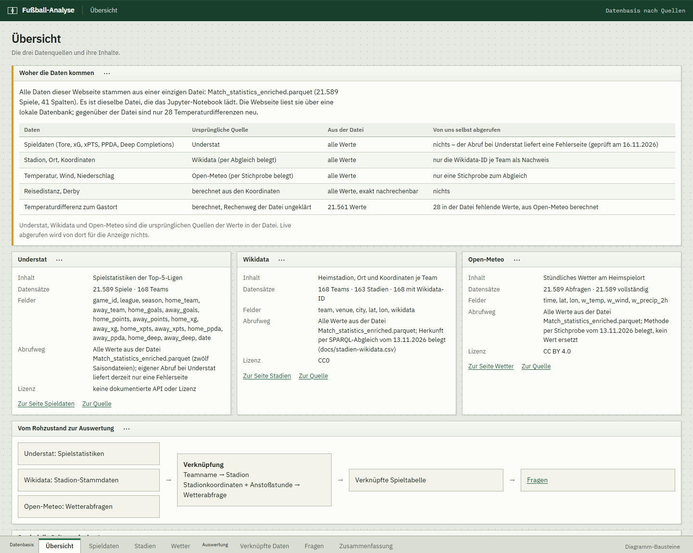
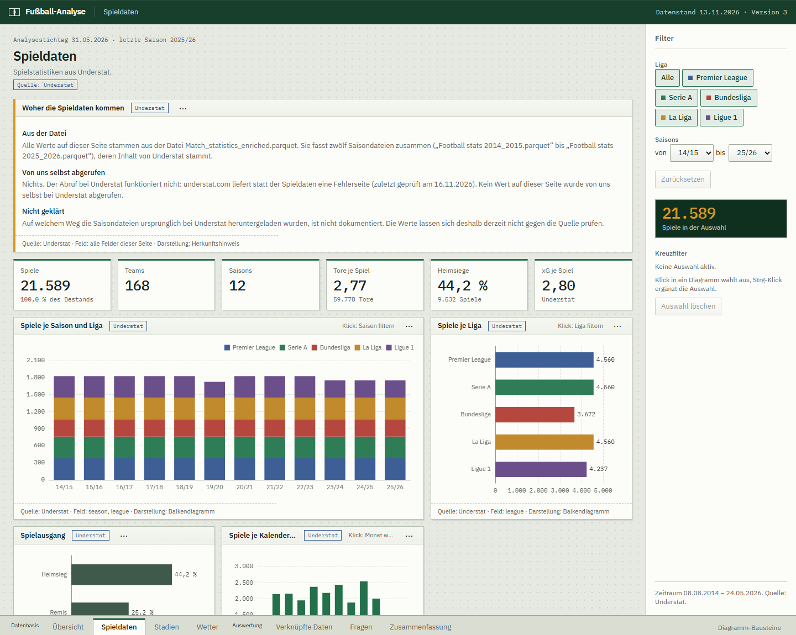
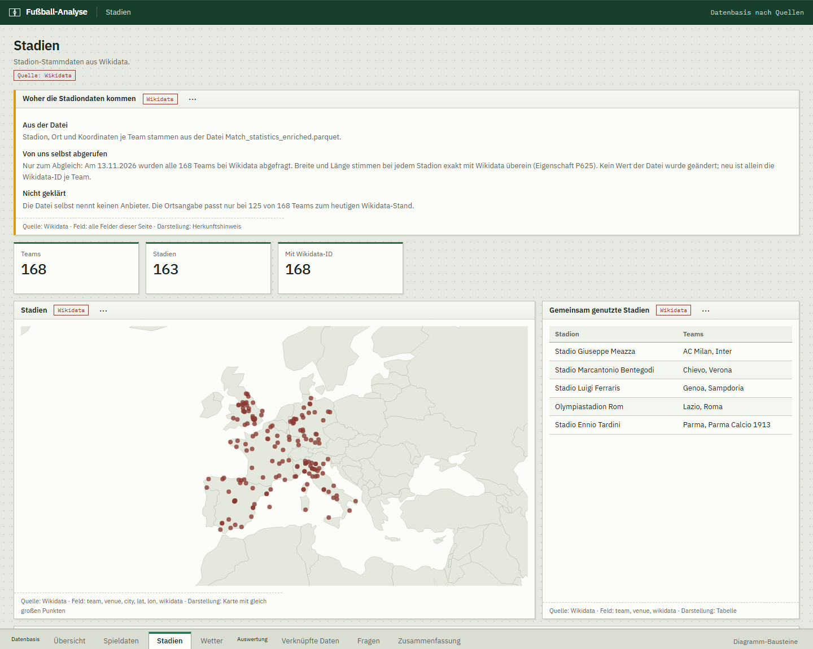
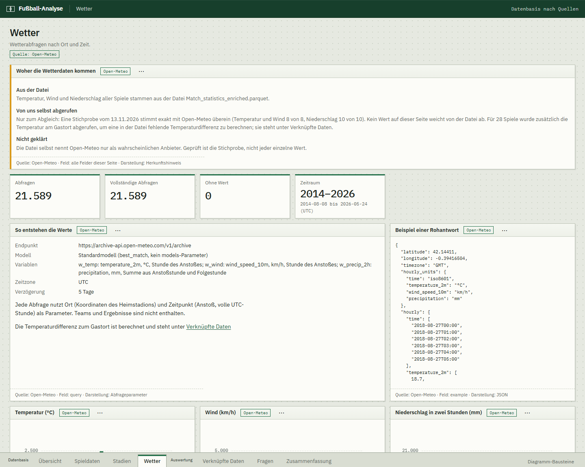
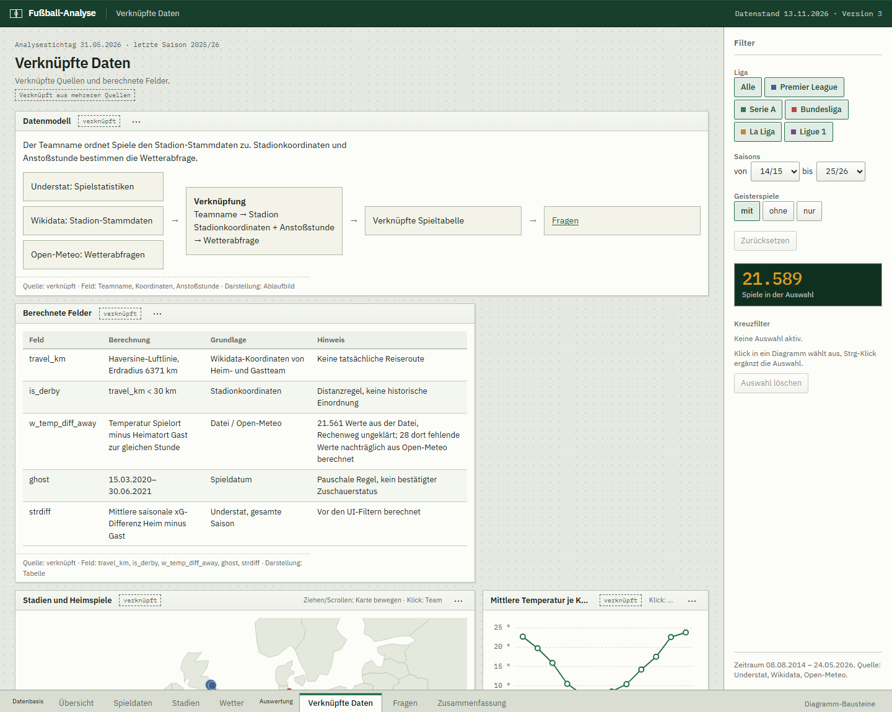

# Fußballanalyse – lokale Webseite und API

FastAPI mit SQLite-Speicher und eine lokale Webseite, die den Datenbestand der Fußballanalyse nach Quellen getrennt zeigt. Die fachlichen Auswertungsseiten und Antworttexte zu den zwölf Fragen folgen frühestens Mitte Dezember 2026 nach Freigabe. Der [lokale Umsetzungsplan](docs/umsetzungsplan.md) hält Umfang und Entscheidungen fest, [docs/quellen.md](docs/quellen.md) die Herkunft der Daten.

## Woher die Daten kommen

Alle angezeigten Werte stammen aus einer Datei: `Match_statistics_enriched.parquet` (21.589 Spiele, 41 Spalten, Top-5-Ligen 2014/15 bis 2025/26). Es ist dieselbe Datei, die das Notebook lädt. Sie liegt nicht im Repository.

| Daten | Ursprüngliche Quelle | Stand |
| --- | --- | --- |
| Spieldaten (Tore, xG, xPTS, PPDA, Deep Completions) | Understat | Nur aus der Datei. Der eigene Abruf bei Understat liefert eine Fehlerseite (zuletzt geprüft am 16.11.2026); der ursprüngliche Downloadweg ist nicht dokumentiert. |
| Stadion, Ort, Koordinaten | Wikidata | Aus der Datei. Koordinaten aller 168 Teams per Abgleich vom 13.11.2026 belegt; Zuordnung in `docs/stadien-wikidata.csv`. |
| Temperatur, Wind, Niederschlag | Open-Meteo | Aus der Datei. Methode per Stichprobe vom 13.11.2026 belegt. |
| Reisedistanz, Derby | berechnet | Aus der Datei, aus den Koordinaten exakt nachrechenbar. |
| Temperaturdifferenz zum Gastort | berechnet | 21.561 Werte aus der Datei, Rechenweg ungeklärt. 28 dort fehlende Werte wurden am 13.11.2026 aus Open-Meteo berechnet; das ist der einzige Unterschied zwischen Datenbank und Datei. |

## Seiten

- Datenbasis: Übersicht, Spieldaten (Understat), Stadien (Wikidata), Wetter (Open-Meteo). Jede dieser Seiten zeigt nur Felder ihrer Quelle und nennt oben, was aus der Datei stammt und was selbst abgerufen wurde.
- Auswertung: Verknüpfte Daten (zusammengeführte Spieltabelle und berechnete Felder), Fragen, Zusammenfassung.
- [Diagramm-Bausteine](http://127.0.0.1:8010/charts.html) als technische Vorschau.

Einzelheiten zur Webseite stehen in [web/README.md](web/README.md).

### Screenshots

Stand 16.11.2026, Datenversion 3.

**Übersicht** – Herkunft der Daten und Steckbrief je Quelle



**Spieldaten (Understat)** – Kennzahlen, Verteilungen und Filter



**Stadien (Wikidata)** – Karte und gemeinsam genutzte Stadien



**Wetter (Open-Meteo)** – Abfrageparameter und Beispiel einer Rohantwort



**Verknüpfte Daten** – Datenmodell und berechnete Felder



## Notebooks

`Fußball_Analyse.ipynb` bleibt unverändert als Referenz erhalten und beantwortet die zwölf Fragen auf Basis der Datei. `Fußball_Analyse_aktuell.ipynb` ist dieselbe Analyse, am 16.11.2026 mit `data/soccer.db` neu ausgeführt. Die Textausgaben sind bis auf F8 identisch; dort gehen 28 Spiele mehr ein (Klimaschock p = 0,69 statt 0,64, Aussage unverändert).

**Fester Datenumfang:** bis einschließlich 31.05.2026, letzte Saison 2025/26. Der Stichtag gilt für Import und API, unabhängig von Browserfiltern. Vorhandene spätere Daten werden nicht gelöscht, aber aus der Auswertung ausgeschlossen. Der tatsächliche letzte Spieltag kann früher liegen als der Stichtag.

## Webseite lokal starten

```powershell
.\start-local.ps1
```

Danach ist die Webseite unter <http://127.0.0.1:8010> erreichbar. Das Skript baut die Webseite und startet den Server im Vordergrund; Strg+C beendet ihn. Port 8010 trennt die Fußballseite von anderen lokalen Projekten wie Auroq.

Python ab 3.12 und uv werden benötigt:

```powershell
uv sync
uv run python -m soccer_api.seed
uv run uvicorn soccer_api.main:app --host 127.0.0.1 --port 8010
```

Die private Datei `data/seed/Match_statistics_enriched.parquet` ist der Startbestand, aus dem `soccer_api.seed` die Datenbank erzeugt. Alternativ kann der Seed-Befehl einen Dateipfad erhalten. Der Quellenabgleich funktioniert auch ohne Seed; Wetter benötigt bekannte Stadionkoordinaten. `SOCCER_DATA_DIR` überschreibt das Datenverzeichnis einschließlich `soccer.db`. Rohdaten und Datenbank dürfen nicht eingecheckt werden.

## Neue Daten aus den Quellen

```powershell
# Letzte enthaltene Saison 2025/26 aller fünf Ligen
.\.venv\Scripts\python.exe -m soccer_api.refresh
# Ein bestimmter historischer Ausschnitt
.\.venv\Scripts\python.exe -m soccer_api.refresh --leagues 3 --seasons 2024,2025 --weather-limit 50
# In einem zweiten Terminal geöffnet lassen: sofort, danach alle 24 Stunden
.\.venv\Scripts\python.exe -m soccer_api.refresh --watch
```

Der Standardlauf lädt die letzte enthaltene Saison 2025/26, nicht automatisch alle Saisons seit 2014. Historische Saisons werden gezielt über `--seasons` nachgeladen. Saisonstartjahre nach 2025 werden vor dem Abruf abgelehnt. Understat wird über eingebettete Ligadaten gelesen und hat keine hier verwendete offizielle API. Wartungsseiten und ungültige Antworten brechen den Lauf ab; vorhandene Spiele bleiben erhalten. Bisher ist kein Abruf bei Understat gelungen: Die Quelle liefert nur eine Fehlerseite, der Live-Import ist deshalb nicht verifiziert.

Wetter kommt aus dem Open-Meteo-Archiv (Standardmodell ohne `models`-Parameter, UTC) mit mindestens fünf Tagen Abstand. Maximal 50 Wetteraufrufe pro Lauf begrenzen den Umfang; ausstehendes Wetter wird in späteren Läufen erneut versucht. Temperatur/Wind verwenden die Anstoßstunde, Niederschlag die Summe aus Anstoßstunde und Folgestunde. Fehlende Koordinaten neuer Teams müssen zunächst in der lokalen Stadiontabelle ergänzt werden. Koordinaten bestehender Teams stammen derzeit aus dem letzten Heimspiel des historischen Startbestands und sind für neue Saisons zu prüfen. Fehlendes Wetter bleibt unbekannt und wird nicht als trockenes oder mildes Wetter ausgewertet.

SQLite speichert den letzten Stand dauerhaft. HTTP-Quellantworten liegen unter `data/source-cache/`; Ligadaten werden zeitlich begrenzt, historische Wetterantworten dauerhaft wiederverwendet. API-Antworten und Modelle werden nach Datenversion gepuffert; ETags und GZip reduzieren Downloads. Der Browser prüft übereinstimmende Versionen von Metadaten und Spielen. Nach einem Aktualisierungslauf die Seite neu laden. Es ist kein Windows-Systemdienst eingerichtet: Ein täglicher Lauf funktioniert nur bei eingeschaltetem Rechner und laufendem `--watch`-Prozess. Der Datenstichtag rückt beim Saisonwechsel nicht automatisch weiter.

Die Dokumentation steht unter `/docs`, die GET-Endpunkte unter `/api/meta`, `/api/matches`, `/api/stadiums`, `/api/models` und `/api/status` sowie je Quelle unter `/api/source/understat`, `/api/source/wikidata` und `/api/source/open-meteo`. Der Status ist auch ohne eingespielte Spiele verfügbar. Ein vorhandenes `web/dist/` wird automatisch ausgeliefert.

## Lokale Betriebsskripte

```powershell
.\start-local.ps1 -SkipBuild             # vorhandenen Produktionsbuild starten
.\scripts\check-local.ps1               # Fußballseite, Datenstichtag und Status prüfen
.\scripts\backup-local.ps1              # konsistente SQLite-Sicherung nach data/backups
.\scripts\refresh-local.ps1             # einmaliger Quellenlauf, Protokoll unter data/logs
.\scripts\refresh-local.ps1 -Watch      # täglich, solange das Terminal geöffnet bleibt
.\scripts\refresh-local.ps1 -WeatherOnly -Seasons '2014,2015,2016,2017,2018,2019,2020,2021,2022,2023,2024,2025'
```

Start und Prüfung akzeptieren `-Port`, standardmäßig 8010. Ein belegter Port wird nicht durch Beenden eines fremden Dienstes freigemacht. Sicherungen verwenden die SQLite-Backup-Schnittstelle und prüfen das Ergebnis. Der Wetterlauf und der Quellenlauf teilen dieselbe Prozesssperre. Der Status auf der Seite Verknüpfte Daten zeigt fehlende Wetterwerte, Koordinaten, Cachegröße und den letzten Lauf; „Status aktualisieren“ liest nur diesen Status neu ein.

```powershell
uv run ruff check .
uv run pytest -q
```

Die Tests verwenden synthetische Daten. Notebook-Parität wird ohne reale Seed-Datei übersprungen. Stadiondaten stammen pro Team aus dem letzten Heimspiel; die Liga aus allen Heim- und Auswärtsspielen. Modelle benötigen mindestens 200 tatsächlich verwendbare Beobachtungen, auch auf Team-Saison-Ebene. Nicht schätzbare Teilmodelle werden als Fehler gemeldet.
